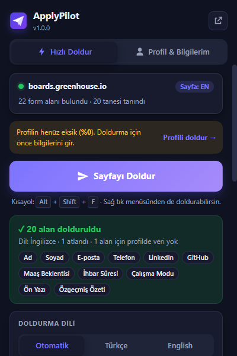
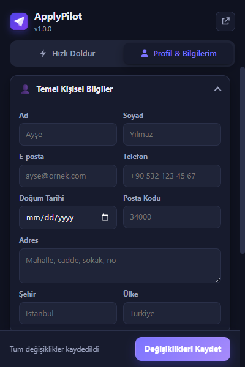
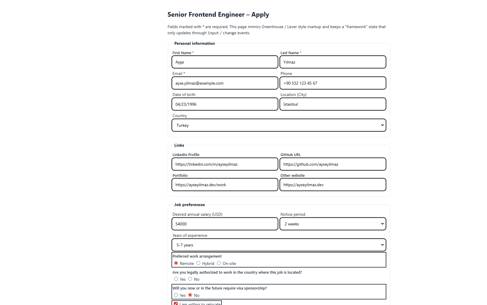

<p align="center">
  
</p>

<h1 align="center">ApplyPilot</h1>

<p align="center">
  İş başvurusu formlarını <strong>Türkçe</strong> veya <strong>İngilizce</strong> profilinle tek tıkla dolduran,
  Chrome · Edge · Brave · Firefox · Zen Browser uyumlu Manifest V3 tarayıcı eklentisi.
</p>

<p align="center">
  <a href="#kurulum">Kurulum</a> ·
  <a href="#özellikler">Özellikler</a> ·
  <a href="#nasıl-çalışır">Nasıl çalışır?</a> ·
  <a href="#english">English</a>
</p>

---

| Hızlı Doldur | Profil & Bilgilerim | Sayfada sonuç |
| --- | --- | --- |
|  |  |  |

## Özellikler

- **Tek seferlik profil:** Kişisel bilgiler, profesyonel linkler (LinkedIn, GitHub, portfolyo, Kaggle, X, Medium), maaş beklentisi (TL / USD / EUR), sıralı çalışma modu tercihleri (Remote / Hibrit / Ofis), ihbar süresi, askerlik durumu, çalışma izni / vize, taşınma tercihi, Türkçe ve İngilizce CV dosyası.
- **İki dilli içerik:** Türkçe ve İngilizce ön yazı, özgeçmiş özeti, deneyim ve eğitim özetleri. Sayfanın dili otomatik algılanır (veya elle seçilir) ve doğru profil kullanılır.
- **Akıllı alan eşleştirme:** `name`, `id`, `placeholder`, `aria-label`, `aria-labelledby`, `autocomplete`, `<label>`, `fieldset/legend` ve çevredeki metinler puanlanarak 30+ alan türü tanınır. Türkçe karakterler normalize edilir (`Adınız` → `adiniz`), camelCase/snake_case isimler ayrıştırılır.
- **React / Vue / Angular uyumu:** Değer, prototipteki yerel `value` setter'ı ile atanır; ardından `input`, `change`, `blur` (ve `focusout`) olayları `bubbles: true` ile fırlatılır. Bu sayede controlled component state'i de güncellenir.
- **Her kontrol türü:** metin, e-posta, telefon, URL, sayı, tarih alanları, `textarea`, `select`, radio grupları, onay kutuları, `contenteditable` editörler ve CV dosya yükleme (`input type="file"`). Açık Shadow DOM ve erişilebilir iframe'ler de taranır.
- **Bağlama duyarlı değerler:**
  - "Annual / yıllık" maaş alanında aylık tutar otomatik ×12 (veya tersi).
  - Alan "USD / $ / €" diyorsa ilgili para birimindeki tutar kullanılır.
  - `5-7 years`, `8+ years`, `50.000 – 60.000 TL` gibi aralık seçenekleri sayısal olarak eşleştirilir.
  - Evet/Hayır sorularında (çalışma izni, vize sponsorluğu, taşınma) doğru seçenek işaretlenir.
  - Tarih, alanın biçimine göre yazılır (`GG.AA.YYYY`, `MM/DD/YYYY`, `type="date"`).
  - `maxlength="10"` olan telefon alanına ülke kodu atılarak sığdırılır.
- **Güvenli varsayılanlar:** Dolu alanların üzerine yazmaz (isteğe bağlı), KVKK/gizlilik onay kutularına dokunmaz, captcha/honeypot alanlarını atlar, ön yazı gibi uzun metinleri sayfada tek bir en uygun alana yazar.
- **Hızlı erişim:** Popup butonu, <kbd>Alt</kbd>+<kbd>Shift</kbd>+<kbd>F</kbd> kısayolu ve sağ tık menüsü. Doldurulan alanlar yeşil çerçeveyle vurgulanır, simgede doldurulan alan sayısı gösterilir.
- **Gizlilik:** Hiçbir sunucu, analitik veya uzak kod yok. Veriler yalnızca `storage.local` içinde tutulur; JSON olarak dışa/içe aktarılabilir.

## Kurulum

Önce depoyu indir: **Code → Download ZIP** (sonra klasöre çıkar) veya

```bash
git clone https://github.com/Berzanu10/ApplyPilot.git
```

### Chrome / Edge / Brave / Opera

1. `chrome://extensions` (Edge'de `edge://extensions`) adresini aç.
2. Sağ üstten **Geliştirici modu**nu aç.
3. **Paketlenmemiş öğe yükle** → depo klasörünü (içinde `manifest.json` olan) seç.
4. Simgeyi araç çubuğuna sabitle. İlk kurulumda profil sayfası otomatik açılır.

### Firefox / Zen Browser

**Geçici yükleme (geliştirme):**

1. `about:debugging#/runtime/this-firefox` adresini aç.
2. **Geçici Eklenti Yükle…** → depo klasöründeki `manifest.json` dosyasını seç.

> Geçici eklentiler tarayıcı kapanınca kaldırılır. Kalıcı kurulum için paketi [addons.mozilla.org](https://addons.mozilla.org/developers/) üzerinden imzalatabilir ya da Firefox Developer Edition / Nightly'de `xpinstall.signatures.required = false` ayarıyla `.zip`'i yükleyebilirsin.

Minimum sürümler: Chrome 121+, Firefox 140+ (Zen Browser güncel sürümler).

### Mağaza paketi oluşturma

```powershell
powershell -ExecutionPolicy Bypass -File tools/package.ps1
```

`dist/applypilot-<sürüm>.zip` oluşur; aynı arşiv Chrome Web Store, Edge Add-ons ve AMO'ya yüklenebilir.

## Kullanım

1. **Profil & Bilgilerim** sekmesinde bilgilerini doldur ve **Değişiklikleri Kaydet**'e bas (<kbd>Ctrl</kbd>+<kbd>S</kbd> da çalışır). Geniş ekranda düzenlemek için sağ üstteki ⤢ butonunu kullan.
2. Bir başvuru sayfasında eklenti simgesine tıkla. Popup sayfadaki form alanlarını ve algılanan dili gösterir.
3. Gerekirse doldurma dilini (Otomatik / Türkçe / English) ve doldurulacak veri kategorilerini seç.
4. **Sayfayı Doldur**'a bas. Göndermeden önce alanları mutlaka kontrol et.

Denemek için `test/` klasöründeki örnek formları ve `test/sample-profile.json` örnek profilini (Profil → Tercihler & Veri Yönetimi → İçe Aktar) kullanabilirsin:

```bash
python -m http.server 8000
# http://localhost:8000/test/sample-form-tr.html
# http://localhost:8000/test/sample-form-en.html
```

## Nasıl çalışır?

```
manifest.json            MV3 manifest (Chrome service_worker + Firefox scripts birlikte)
popup/
  popup.html             Sekmeli arayüz (popup ve tam sayfa ayarlar olarak kullanılır)
  popup.css              Açık/koyu tema, responsive düzen
  popup.js               Sekmeler, tarama, doldurma, profil formu, içe/dışa aktarma
scripts/
  shared.js              Cross-browser API sarmalayıcı, depolama şeması, enjeksiyon mantığı
  background.js          Service worker / event page: kısayol, sağ tık menüsü, rozet
  content.js             Form motoru: alan keşfi, puanlama, dil algılama, değer atama
icons/                   16/32/48/128 PNG ve kaynak SVG
tools/                   İkon üretme ve paketleme scriptleri
test/                    Örnek TR/EN formlar ve örnek profil
```

**Cross-browser katmanı.** Tüm scriptler `const extensionAPI = typeof browser !== 'undefined' ? browser : chrome;` sarmalayıcısını kullanır ve yalnızca Promise tabanlı API'leri çağırır. `manifest.json` içinde hem `background.service_worker` (Chrome) hem `background.scripts` (Firefox/Zen) tanımlıdır; her tarayıcı kendi desteklediği anahtarı kullanır. Chrome'da `shared.js`, `importScripts` ile yüklenir.

**Enjeksiyon.** Eklenti sürekli çalışan bir content script kullanmaz. `activeTab` + `scripting` izinleriyle, yalnızca sen popup'ı açtığında, kısayola bastığında veya sağ tık menüsünü kullandığında `content.js` sayfaya (ve erişilebilen tüm iframe'lere) enjekte edilir. Bu sayede geniş site izni (`<all_urls>`) gerekmez.

**Eşleştirme.** Her form kontrolü için etiket, placeholder, nitelik ve bağlam metinleri normalize edilip kural listesine karşı puanlanır (etiket 10, placeholder 6, nitelik 5, bağlam 4, uygun `type` bonusu, `autocomplete` eşleşmesi 100). Negatif kalıplar yanlış eşleşmeleri engeller: örneğin "Şirket adı" ad alanı, "Doğum yeri" doğum tarihi, "Referans e-postası" e-posta olarak görülmez.

### Bilinen sınırlamalar

- Workday gibi tamamen özel (div tabanlı) açılır menüler doldurulmaz. Gizli veya tamamen özel sürükle-bırak CV kutuları her sitede çalışmayabilir; klasik `input type="file"` alanları doldurulur.
- Farklı origin'den gelen bazı iframe'lere `activeTab` izniyle erişilemeyebilir.
- Bazı siteler `isTrusted` kontrolü yaparak programatik olayları reddedebilir.

## Katkı

Hata bildirimleri ve pull request'ler memnuniyetle karşılanır. Yeni bir alan türü eklemek için `scripts/content.js` içindeki `RULES` listesine bir kural ve `RESOLVERS` nesnesine değer üretici eklemen yeterli; profile yeni bir alan gerekiyorsa `scripts/shared.js` içindeki `DEFAULT_PROFILE` ve `popup/popup.html` formunu güncelle.

## Lisans

[MIT](LICENSE)

---

## English

**ApplyPilot** is a cross-browser (Chrome, Edge, Brave, Firefox, Zen) Manifest V3 extension that fills job application forms from a single profile in **Turkish or English**.

- Stores personal info, professional links, salary expectations in TRY/USD/EUR, work mode, notice period, military service, work authorization / visa, and bilingual cover letters, résumé summaries, experience and education texts — locally in `storage.local`.
- Detects the page language automatically (or lets you pick one) and uses the matching profile.
- Heuristic matching over `name`, `id`, `placeholder`, `aria-*`, `autocomplete`, `<label>`, `fieldset/legend` and nearby text, with Turkish-aware normalization and negative patterns.
- Framework-friendly filling: native value setter + bubbling `input`, `change`, `blur` events so React / Vue / Angular state updates.
- Handles text inputs, textareas, selects (including numeric ranges), radio groups, checkboxes, `contenteditable` editors, open shadow roots and accessible iframes.
- Trigger from the popup, <kbd>Alt</kbd>+<kbd>Shift</kbd>+<kbd>F</kbd> or the context menu. No servers, no analytics, no remote code.

**Install:** Chrome → `chrome://extensions` → Developer mode → *Load unpacked* → select the repo folder. Firefox / Zen → `about:debugging#/runtime/this-firefox` → *Load Temporary Add-on* → pick `manifest.json`.
